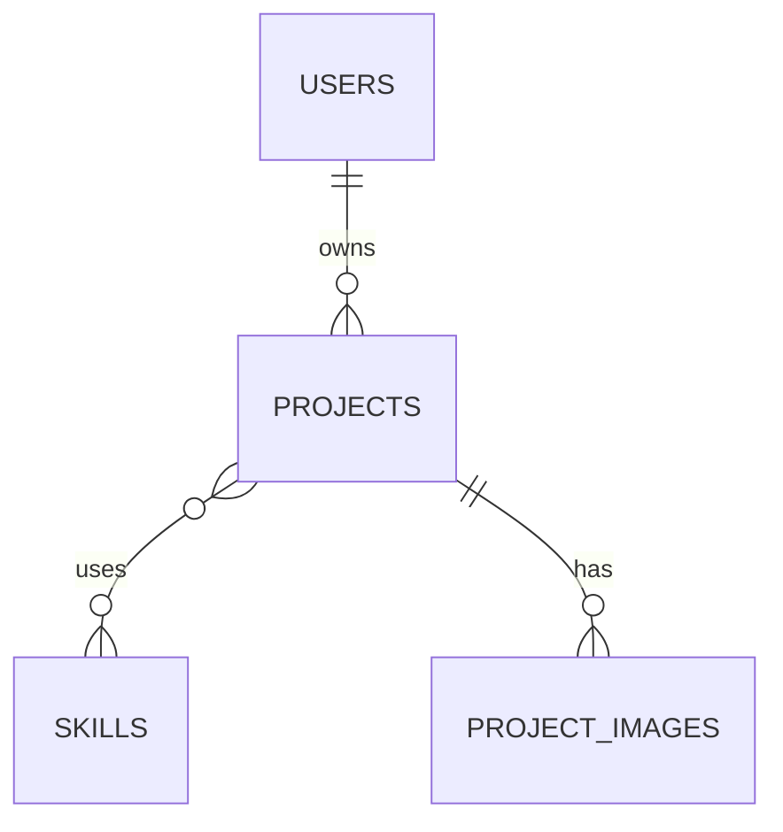

# Database Design Playbook

## Process

1. **List entities & use-cases.** Write each screen/report/query the app needs. The schema serves queries.
2. **Define relationships.** One-to-many (FK on the "many" side), many-to-many (pivot), one-to-one (FK + unique), polymorphic (only when justified).
3. **Choose keys and types.** Bigint ids by default; ULIDs for public-facing IDs; decimals/integers for money; `string` + enum for statuses; `json` only for schemaless metadata.
4. **Add constraints.** FKs with deliberate on-delete; unique keys; `NOT NULL` + defaults.
5. **Plan indexes** from the query list (equality columns first, then range/sort).
6. **Write migrations** in dependency order (parents before children), each with `down()`.
7. **Write factories + seeders** that produce valid realistic data.
8. **Validate:** `migrate:fresh --seed`, `migrate:rollback`, then run the main queries with `EXPLAIN` on realistic data volume.

## Deliverable format

Provide an ERD in text/Mermaid, then a table per entity:

| Column | Type | Null | Default | Index/Constraint | Notes |
|---|---|---|---|---|---|

## Decision guides

- **Soft delete vs hard delete:** soft for user-visible content that may be restored or audited; hard for ephemeral data. Mind unique indexes with soft-deleted rows.
- **Settings storage:** key/value table (`settings`) with cached read, or a single-row table for a fixed set of typed fields.
- **Translations:** separate `*_translations` tables or JSON columns (`spatie/laravel-translatable`) — choose one project-wide.
- **Ordering:** `sort_order` integer; reorder via a transactional bulk update.
- **Media:** `media` table (path, disk, mime, size, alt) + relations, or a package (spatie/medialibrary) for complex needs.
- **Audit/history:** only when required; use a package or an `activity_log` table.

## Anti-patterns

- Floats for money. Comma-separated IDs in a column. Storing files in the DB. Unindexed foreign keys. DB `enum` columns that change often. Business rules only in the UI. Editing deployed migrations.
